  <a href="https://tamir39.com/">
    <picture>
      <source media="(prefers-color-scheme: dark)" srcset="./assets/profile-hero-dark.svg" />
      
    </picture>
  </a>

  <a href="https://tamir39.com/"><strong>Explore my portfolio ↗</strong></a>
  &nbsp; · &nbsp;
  <a href="https://www.linkedin.com/in/tam-phi-vuong-tuong-686919388/">LinkedIn ↗</a>
  &nbsp; · &nbsp;
  <a href="https://zuno.page/">Zuno ↗</a>

## A little about me

I'm **Tamir — Phí Vương Tường Tâm**, a frontend developer and UI/UX designer at **Twohearts Technology**, and a computer science student at **Ton Duc Thang University**.

I bring visual design and application logic together: clear layouts, thoughtful interactions, and user flows that hold together from the first click to the final step. I enjoy exploring type, color, motion, and the details that make an interface feel as good as it works.

**Currently exploring →** Deeper UI/UX practice and full stack development through my own product, Zuno.

**My focus:** visual craft, thoughtful user flows, and interfaces connected to application logic.

## Work & recognition

### Twohearts Technology

**Frontend Developer & UI/UX Designer · June 2026–present**

Dashboard and storefront work spanning UI/UX design, visual refinement, user flows, and frontend integration.

<a href="https://www.linkedin.com/posts/genai-fund_aabw2026-aabwxgaf-activity-7482359686189445120-FEhQ">
  <picture>
    <source media="(prefers-color-scheme: dark)" srcset="./assets/achievement-dark.svg" />
    
  </picture>
</a>

Part of the winning Twohearts team. <a href="https://www.linkedin.com/posts/genai-fund_aabw2026-aabwxgaf-activity-7482359686189445120-FEhQ">Organizer's announcement ↗</a>

## Something of my own

<a href="https://zuno.page/">
  <picture>
    <source media="(prefers-color-scheme: dark)" srcset="./assets/zuno-card-dark.svg" />
    
  </picture>
</a>

**[Zuno](https://zuno.page/)** is my personal application: a private social timeline organized into shared spaces called **Zones**. Members share text and images, react to posts, and vote within their space.

It's where I explore the entire product flow—from joining a Zone to sharing and interacting with its timeline—and build experience beyond the frontend.

**Built with:** Next.js · React · TypeScript · Tailwind CSS · Zustand · PostgreSQL · Drizzle ORM

## Tools behind the work

**Core frontend** &nbsp; React · TypeScript · Tailwind CSS · Next.js · Vite 
**Components & motion** &nbsp; shadcn/ui · Radix UI · Motion / Framer Motion 
**State & data** &nbsp; Zustand · TanStack Query 
**Growing full stack experience** &nbsp; PostgreSQL · Drizzle ORM

---

<strong>What could we create in your next product?</strong>

  <a href="https://tamir39.com/#contact">Let's connect ↗</a>
  &nbsp; · &nbsp;
  <a href="https://www.linkedin.com/in/tam-phi-vuong-tuong-686919388/">LinkedIn</a>
  &nbsp; · &nbsp; <strong>0938 419 071</strong>

Tamir / A little design, a little code, a little wonder.

## GitHub activity

  <picture>
    <source media="(prefers-color-scheme: dark)" srcset="./assets/github-dashboard-dark.svg" />
    
  </picture>

Dated public snapshot; private work excluded. The calendar and charts count indexed public commits, and languages are counted by original repository. Motion respects your reduced-motion preference. <a href="https://raw.githubusercontent.com/tamir39/tamir39/main/assets/github-dashboard-static.svg">Still view ↗</a>
